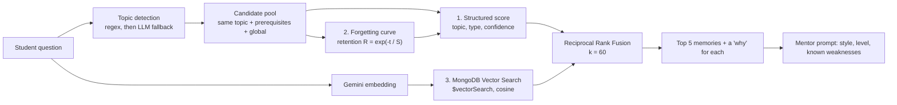

# IntelliPrep (PrepPulse) 🧠

**A DSA interview mentor that remembers *why* you got stuck, forgets what is stale, and changes how it teaches you next time.**

Built for **UNCHARTED 2026 · MongoDB Track 1: Agentic Memory** (NEXUS × SVNIT Surat).

| | |
|---|---|
| **Live app** | `<paste deployed URL>` |
| **Repository** | `<paste GitHub URL>` |
| **Demo access** | On the login screen click **Explore with demo account** (`demo@intelliprep.dev`, no password). **Reset to demo data** in the user menu restores the baseline. |

---

## The problem

Practice platforms are amnesiac. You fail a recursion problem because of a missing base case, learn it clicks with call-stack diagrams, close the tab, and the platform forgets all of it. The next explanation is the same generic one.

IntelliPrep keeps **evidence-backed memories** about each student (what they get wrong, which teaching style worked, what they have already mastered), retrieves the right ones for every new question, and lets that memory visibly change the next answer. The student can open the **Memory Vault** to inspect, correct or delete anything it knows.

---

## What makes the memory good: the recall engine

Memory is only useful if the *right* memory comes back at the *right* time. Recall is the core of IntelliPrep, and it combines three signals, each of which fails safe.



### 1. Structured relevance (explainable by construction)

Every candidate memory gets a score you can read off the screen:

```
score = topic match   (3 same topic · 2 prerequisite topic · 1 applies to all topics)
      + type bonus    (+1 learning_preference or mistake)
      + 2 × confidence
      + retention R   (forgetting curve, below)
      + 1 if the student corrected it by hand
```

Prerequisites matter: asking about *trees* also recalls what you struggled with in *recursion*. The best "worked" and best "failed" teaching-style memories for the topic are always included, even if the score cut-off would drop them.

### 2. Forgetting curve (memory that decays like a real one)

A flat "last 14 days" cut-off treats a two-week-old preference and a two-hour-old guess alike. Instead every memory has a **retention** based on Ebbinghaus-style exponential decay:

```
R = exp( −days since last verified / S )

S = S0(type) × (1 + 0.5·ln(1 + #evidence)) × min(2, 1 + 0.25·ln(1 + useCount)) × (3 if corrected)
```

| Memory type | Base stability S0 |
|---|---|
| `learning_preference` | 30 days |
| `strength`, `weakness` | 21 days |
| `concept_understood` | 14 days |
| `mistake` | 10 days |
| `revision_needed` | 5 days |

More evidence makes a memory last longer, being recalled and useful reinforces it (capped, so nothing snowballs), and a memory the student corrected by hand decays three times slower. Stale memories lose ranking smoothly and show up in the UI as `fading: retention 41%`.

### 3. Semantic recall with MongoDB Vector Search

Regex topic detection misses things like *"my function keeps running forever and the stack blows up"*. So each memory is also embedded (Gemini `gemini-embedding-001`, 768 dimensions, cosine) and stored in the same document. The student's question is embedded and matched with `$vectorSearch`, filtered to that student's memories.

Semantic hits **re-rank the candidate pool; they never add memories the structured rules excluded**, so topic scoping stays strict and explainable.

### Fusing the rankings: Reciprocal Rank Fusion

The structured and semantic rankings are merged with RRF, the same formula MongoDB's `$rankFusion` uses:

```
fused(m) = 1 / (60 + rank_structured(m)) + 1 / (60 + rank_semantic(m))
```

RRF needs no score calibration between a hand-built score and a cosine similarity, which is why it is the safe way to blend them. A memory that both rankings agree on rises to the top, and its explanation says so:

> *past mistake; topic match: recursion; semantic match 0.91 (#1)*

### Built to fail safe

Semantic recall is strictly additive. If there is no Gemini key, the Atlas index is still building, the cluster is not Atlas, or the API is slow, the vector step returns nothing and recall falls back to the structured ranking, with the forgetting curve still active. Circuit breakers stop a failing API from slowing down chat. `GET /api/health` reports which mode is live:

```json
"recall": { "mode": "hybrid (structured + semantic + forgetting curve)", "index": "ready", ... }
```

---

## Memory model and lifecycle

Each memory is one MongoDB document (`student_memories`):

| Field | Purpose |
|---|---|
| `userId`, `type`, `topic`, `content` | owner, one of `strength` · `weakness` · `mistake` · `learning_preference` · `concept_understood` · `revision_needed`, one of 10 DSA topics (or `*`), the fact |
| `evidence[]` | every observation behind the memory: text, source (`chat` · `practice` · `manual` · `seed`), reference id, timestamp |
| `confidence`, `useCount`, `lastUsedAt`, `lastVerified` | how sure we are, how often it was recalled, and freshness (drives retention) |
| `status`, `supersededBy` | `active` → `superseded` (linked to the memory that replaced it) or `corrected` by the student |
| `expiresAt` | **TTL index**: tentative memories expire on their own |
| `embedding` | 768-d vector for Vector Search (hidden from API responses) |

**When memory is written.** Every write passes one gate (`memory/gate.js`): a degraded or fallback AI reply teaches nothing; feedback is idempotent; emails, phone numbers and credentials are never stored; small talk and low-importance chatter are skipped; the topic must be valid; there must be concrete evidence.

**How memory is updated, corrected, forgotten:**

| Event | What happens |
|---|---|
| First wrong attempt | `mistake` at confidence 0.4 (no weakness yet) |
| Same error again | evidence added, `mistake` → 0.7, a `weakness` is created |
| Two passes in a row on a weak topic | the weakness becomes `superseded`, linked to a new `strength` |
| A teaching style works | preference 0.6 → 0.75 → 0.9; works on two topics → a global preference (0.85) |
| A style fails | tentative 0.4 with a **3-day TTL**, then 0.6 → 0.75; a contradicted "worked" memory loses 0.25 and is superseded below 0.3 |
| Fact stated in chat | saved tentatively (0.5) with a **7-day TTL** until confirmed |
| "I'm comfortable with recursion now" | the weakness drops 0.25 and is flagged `needs_verification` |
| Student edits a memory in the Vault | becomes `corrected`, confidence 0.95, **never overwritten again** (only evidence is appended) |
| Student deletes a memory | the document and its embedding are gone |

### Learned strategies change the next answer

Memory drives the mentor in two places:

- **Style ranking (`memory/styles.js`)**: six styles (`theory`, `simple`, `example`, `visual`, `analogy`, `dry_run`) are scored from past outcomes: worked on this topic (+3×confidence), worked on a prerequisite (+2×), worked globally (+1.5×), failed (−2 to −4). The "I didn't understand" ladder never repeats a style, and the UI shows why each was chosen.
- **Understanding level (`memory/understanding.js`)**: check questions move the student between `basic`, `intermediate` and `advanced` wording, and remembered concepts they already handle are not re-taught.

---

## MongoDB features used

| Feature | Where |
|---|---|
| Document model with provenance (evidence array, lifecycle fields) | `models/Memory.js` |
| Compound indexes for recall and lifecycle queries | `models/Memory.js` |
| **TTL index** on `expiresAt` (`expireAfterSeconds: 0`) | tentative memories, `revision_needed` |
| **Atlas Vector Search** (`$vectorSearch`, cosine, `userId` pre-filter) | `memory/vectorIndex.js` |
| Rank fusion (RRF) of structured + vector results | `memory/recall.js` |
| Native-driver writes that leave `updatedAt` untouched | embedding backfill |

---

## Architecture

```
React 18 + Vite + Tailwind  ──REST (x-user-id)──▶  Express API
                                                     ├─ memory/   gate · lifecycle · retrieve · recall · styles · ladder · quiz
                                                     ├─ ai/       Gemini (primary + fallback model) with graceful degradation
                                                     └─ routes/   chat · practice · memories · dashboard · activity · profile · demo
                                                     │
                                       MongoDB Atlas ┘  student_memories (+ vector index) · chat sessions · attempts · mastery · activity
```

The AI layer never throws: if every provider fails the app answers with a flagged fallback and **learns nothing from it**.

---

## Setup

Requirements: Node 18+, a MongoDB Atlas cluster (the free tier is enough), a Gemini API key.

```bash
git clone <repo-url> && cd PrepPulse

# backend
cd server && cp .env.example .env     # fill in MONGODB_URI and GEMINI_API_KEY
npm install
npm run seed                          # demo student + baseline memories
npm run dev                           # http://localhost:5000

# frontend (new terminal)
cd client && cp .env.example .env && npm install && npm run dev   # http://localhost:5173
```

### Environment variables (`server/.env`)

| Variable | Required | Notes |
|---|---|---|
| `MONGODB_URI` | yes | Atlas connection string |
| `GEMINI_API_KEY` | yes | used for mentoring **and** embeddings |
| `GEMINI_MODEL` / `GEMINI_FALLBACK_MODEL` | no | default `gemini-3.1-flash-lite` |
| `FALLBACK_API_KEY`, `FALLBACK_BASE_URL`, `FALLBACK_MODEL` | no | any OpenAI-compatible backup provider |
| `EMBED_MODEL`, `EMBED_DIMS` | no | default `gemini-embedding-001`, `768` (must match the index) |
| `RECALL_MIN_SIM` | no | minimum Atlas similarity score for a semantic hit, default `0.6` |
| `DISABLE_VECTOR` | no | `1` turns semantic recall off |
| `CLIENT_ORIGIN`, `PORT`, `AI_TIMEOUT_MS` | no | CORS origin (comma-separated), port, AI timeout |

Frontend: `VITE_API_URL` (default `http://localhost:5000/api`).

### The vector index

On startup the server creates the Atlas Vector Search index `memory_vector_index` if it is missing (Atlas builds it in about a minute). To create it by hand instead, open **Atlas → Search & Vector Search → Create → Vector Search → JSON editor**, choose database `intelliprep` (or yours), collection `student_memories`, and paste:

```json
{
  "fields": [
    { "type": "vector", "path": "embedding", "numDimensions": 768, "similarity": "cosine" },
    { "type": "filter", "path": "userId" }
  ]
}
```

Name it `memory_vector_index`. Existing and new memories are embedded automatically in the background.

### Verify semantic recall

```bash
cd server && npm run recall:check
```

This checks the Gemini call, the index, embeds the demo memories and runs meaning-only questions (no topic keywords), printing the matches and similarity scores. `GET /api/health` shows the live mode.

### Tests

```bash
cd server && npm test
```

Covers the forgetting curve, RRF, retrieval with the database stubbed, the exact `$vectorSearch` pipeline and index definition, embedding failure paths, the feedback-intent classifier, the understanding model and the full chat flow with a fake database and fake AI. `npm run recall:check` is the live test for the part that needs a real Atlas cluster, and `scripts/memory-e2e.mjs` runs the acceptance flow against a running server.

---

## Demo walkthrough (maps to the track brief)

1. **Create a memory.** Ask *"Teach me recursion"*, reply *"I don't understand"* until an explanation lands, then say *"got it"*. A preference memory is saved with the exact message as evidence.
2. **See it change the next session.** Open a new chat and ask about trees or graphs. The **Memories used** panel lists what was recalled and why (`prerequisite topic: recursion`, `semantic match 0.9`), and the mentor opens with the style that worked.
3. **Inspect.** Open the **Memory Vault**: evidence trail, confidence, status, expiry.
4. **Hard cases.** Correct a memory (it locks at 0.95); say you are now comfortable with a weak topic (confidence drops and it asks for verification); paste an email or phone number (refused by the gate); watch a tentative memory expire via TTL; pass two problems in a row and see a weakness superseded by a strength.

---

## API

`POST /api/auth/login` · `GET /api/auth/me` · `POST /api/chat` · `GET|DELETE /api/chat/sessions[/:id]` · `POST /api/chat/feedback` · `POST /api/chat/practice-review` · `GET /api/memories` · `PATCH|DELETE /api/memories/:id` · `GET /api/practice/questions` · `POST /api/practice/submit` (optionally tagged with the chat `sessionId`, so the mentor reviews your code in the same conversation using the same recalled memories) · `GET /api/dashboard` · `GET /api/activity/summary` · `POST /api/activity/ping` · `GET|PATCH /api/profile` · `POST /api/demo/reset` · `GET /api/health`

---

## Honest limitations and roadmap

- **Authentication** is a demo-grade `x-user-id` header, not production auth.
- **Similarity threshold** (`RECALL_MIN_SIM`) is a sensible default, not tuned on a large dataset.
- **Personal-data gate** is rule-based (email, phone, credentials) and will not catch everything.
- **Next:** spaced-repetition nudges when a weakness's retention falls below a threshold, MMR diversity in the top results, and Change Streams for a shared multi-agent mock-interview panel.

---

## Third-party components

Google Gemini API (generation and embeddings) · MongoDB Atlas, Mongoose and the MongoDB Node driver · Express · React, React Router, Vite · Tailwind CSS · Lucide icons · Axios. The recall methods build on the Ebbinghaus forgetting curve and Reciprocal Rank Fusion (Cormack, Clarke & Büttcher, 2009). Built with the help of AI coding assistants, as permitted by the track rules.
